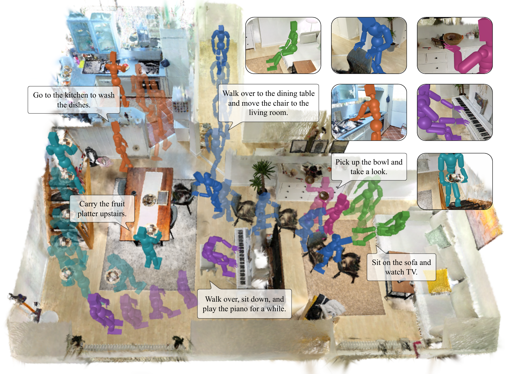
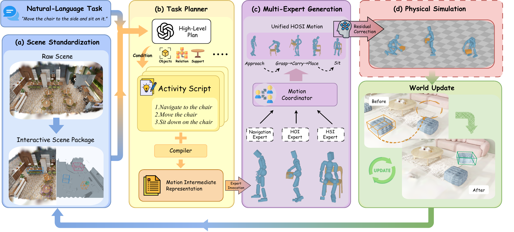
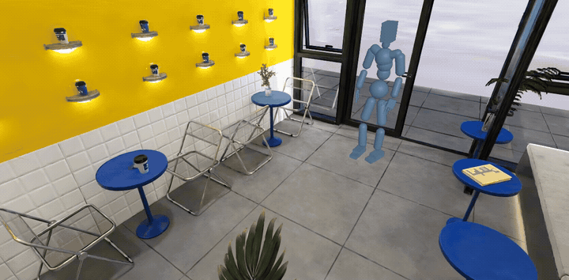
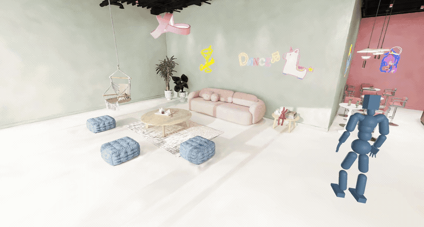

<p align="center">
  
</p>

<h1 align="center">A Multi-Expert Harness for Long-Horizon<br>Human-Object-Scene Interaction Generation</h1>

<p align="center">
  Jiushu Li<sup>1</sup>,
  Haoran Wang<sup>1</sup>,
  Yumeng Liu<sup>2</sup>,
  Zhiyang Dou<sup>3</sup>,
  Yuan Liu<sup>4</sup>,
  Yuexin Ma<sup>5</sup>,
  Cheng Lin<sup>1,†</sup>
</p>

<p align="center">
  <sup>1</sup> Macau University of Science and Technology &nbsp;&nbsp;
  <sup>2</sup> University of Science and Technology of China<br>
  <sup>3</sup> Massachusetts Institute of Technology &nbsp;&nbsp;
  <sup>4</sup> The Hong Kong University of Science and Technology<br>
  <sup>5</sup> ShanghaiTech University<br>
  <sup>†</sup> Corresponding author
</p>

<p align="center">
  <a href="https://arxiv.org/abs/2610.27725"></a>
  <a href="https://arxiv.org/pdf/2610.27725"></a>
  <a href="https://nintreesssss.github.io/World2HOSI/"></a>
  <a href="https://github.com/nintreesssss/World2HOSI-release"></a>
</p>



## 🔥 News
- [2026.10.22] We have released our Github repo. The code is coming soon!
- [2026.10.21] 🚀🚀🚀We have released our [Paper](https://arxiv.org/abs/2610.27725) on arxiv.

## 📖 Abstract

Long-horizon human-object-scene interaction (HOSI) is central to embodied AI, animation, and game development. Existing human-object interaction (HOI) and human-scene interaction (HSI) models excel in their respective domains, but none alone covers tasks requiring multiple interaction skills. Training unified HOSI models is hindered by scarce and costly data.

We introduce **World2HOSI**, a multi-expert orchestration harness that generates continuous HOSI data from 3D Gaussian Splatting (3DGS) scenes and natural language instructions. Our key insight is that long-horizon HOSI hinges not on a stronger single model but on orchestration. Given a shared, structured scene state and an orchestration harness grounded in it, existing experts can jointly accomplish tasks beyond the reach of any of them alone.

**World2HOSI** realizes this insight as a closed loop around a persistent scene state built from decoupled background and object assets. A harness plans action stages over this state, invokes experts via their native conditioning interfaces, and writes each action's effects back, so that every invocation is grounded in the evolving world.

To reduce physical artifacts, bounded residual optimization and contact-driven physics simulation further ensure the physical plausibility of human motion and object manipulation, respectively, while preserving interaction intent. Experiments and a perceptual user study show that **World2HOSI** achieves the best task completion and interaction quality on the evaluated HOSI tasks, while generating more diverse data. We created an interactive demo on our [Project Page](https://nintreesssss.github.io/World2HOSI/).

## 🔎 Overview



> Given a 3D scene and a task instruction, **World2HOSI** coordinates motion experts to generate continuous, long-horizion human–object–scene interactions (HOSI).

## 🚶 Long-Horizon Examples

### 🤖 Move a Chair, Drink Coffee, and Sit Down.



> <p><i>"Move the chair to the threshold, then walk over and take a sip of coffee. After finishing it, place the cup on the nearby table, and finally sit down in the chair."</i></p>

### 🎮 Move Books, Adjust a Stool, and Sit Down.



> <p><i>"Walk over and move the books to the table nearby, then walk over and adjust the stool, and finally sit down."</i></p>

## 🙏 Citation

If you find **World2HOSI** useful in your work, please consider citing:

```bibtex

@article{li2026world2hosi,
  title={World2HOSI: A Multi-Expert Harness for Long-Horizon Human-Object-Scene Interaction Generation},
  author={Li, Jiushu and Wang, Haoran and Liu, Yumeng and Dou, Zhiyang and Liu, Yuan and Ma, Yuexin and Lin, Cheng},
  journal={arXiv preprint arXiv:2610.27725},
  year={2026},
  url={https://arxiv.org/abs/2610.27725}
}
